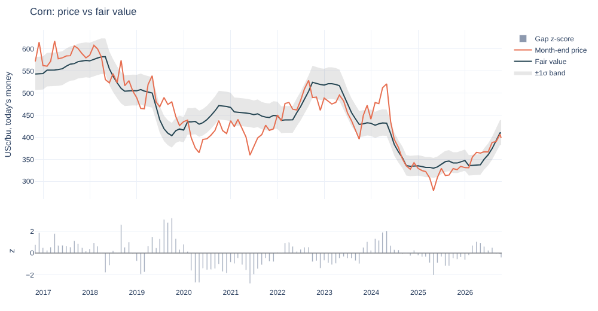
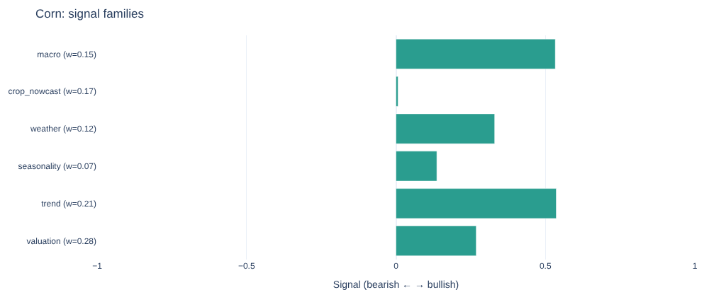

# Agricultural Commodities Analytics

A Python framework for agricultural commodity markets (corn, soybeans, wheat, cotton, coffee,
cocoa, sugar). For each contract it produces

- a **fair-value estimate** from stocks-to-use, the US dollar and crude oil,
- a **crop-health nowcast** built from weather, soil moisture, vegetation (NDVI) and geography,
- a **market regime** (calm / normal / turbulent) from a Markov-switching model,
- a **directional score**, a **P(up)** for the next four weeks and a **trust factor** that says how
  much to believe the call.

Stack: Python, pandas, NumPy, SciPy, statsmodels, scikit-learn, Plotly, Streamlit.

> The repository ships **no market data and no vendor code**. It runs out of the box on a synthetic
> market with a known data-generating process, and reads your own data from CSV files. Every number
> in this README comes from that synthetic market, so it shows that the machinery works, not that it
> makes money.



## Setup

Requires Python 3.10 or newer.

```bash
git clone https://github.com/tudosevlad1234/agri-commodities-analytics.git
cd agri-commodities-analytics
python -m venv .venv
source .venv/bin/activate        # Windows: .venv\Scripts\activate
pip install -e ".[dev]"
```

Check the install (a couple of minutes):

```bash
python -m pytest
```

## Run it

```bash
python -m agri demo --out outputs
```

This analyses all seven contracts on synthetic data (about a minute and a half), prints a summary
table and writes `outputs/report.html`, a single page with one section per contract. Plotly is
embedded in the page (about 6 MB), so it opens offline; add `--cdn` for a small file that loads
Plotly from the internet instead.

Use `--contracts corn,wheat` for a subset and `--horizon 8` for an 8-week forecast horizon.

Interactive app:

```bash
streamlit run agri/app.py
```

From Python:

```python
from agri.pipeline import analyse_contract
from agri.synthetic import generate

report = analyse_contract(generate(seed=7), "wheat")
print(report.fair_value.gap_pct, report.crop.supply_shock_pct, report.regime.state)
print(report.score.score, report.score.p_up, report.score.trust)
```

## Using your own data

```bash
python -m agri export-template my_inputs     # writes an example folder in the right format
python -m agri run --data my_inputs --out outputs
```

The input folder holds seven CSV files:

| File | Columns |
| --- | --- |
| `prices.csv` | `contract, date, close` (daily futures settlements, one continuous series per contract) |
| `stocks_to_use.csv` | `contract, season, value` (ending stocks / use, as a ratio, by marketing year) |
| `macro.csv` | `date, usd, crude, cpi` (one row per month; `usd` and `crude` required, `cpi` optional, used for deflating) |
| `weather.csv` | `region, date, tmax, tmin, rain, soil` (daily; soil is a 0-1 moisture index) |
| `ndvi.csv` | `region, date, ndvi` (vegetation index; averaged to months) |
| `yields.csv` | `region, season, log_yield` (log of regional yield by crop season) |
| `regions.csv` | `region, contract, country, latitude, longitude, share, window, frost_sensitive` |

Contract keys are `corn, soybeans, wheat, cotton, coffee, cocoa, sugar`. A region's `window` is the
space-separated list of months that matter for the crop (for example `6 7 8`); `share` is its
weight in world supply.

Timing rules the code relies on:

- each macro row is treated as known at the end of its month; a month with no row yet (the current
  one) uses the previous month's values;
- a regional yield is only used for training once three months have passed since the end of its
  crop window (`YIELD_LAG_MONTHS` in `crop_health.py`);
- weather months with fewer than 20 days of data are left out, so a half-finished month is not
  mistaken for a drought or a heatwave;
- `stocks_to_use.csv` should hold the estimate that was available at the time (for example USDA
  WASDE vintages). Final, revised figures make the historical fair value look better than it was.

## How it works

**Fair value** (`agri/fair_value.py`). The real (CPI-deflated) log month-end price is explained by
log stocks-to-use, the dollar and crude. Three models: a sign-constrained ridge on log
stocks-to-use, a working-curve model on 1/stocks-to-use (both refitted each January on the previous
ten years), and a Kalman time-varying-coefficient regression (one step ahead). They are combined
with weights proportional to the inverse of each model's squared error over the previous 60 months,
so the historical fair value uses no future information. The stocks-to-use input blends the current
and next marketing year as the new crop approaches. Sign constraints (higher stocks-to-use cannot
raise the fair price) are enforced with bounded least squares. The report gives the fair value, the
gap in percent and in standard deviations, out-of-sample R², an Engle-Granger cointegration p-value
and the half-life of deviations.

**Crop-health nowcast** (`agri/crop_health.py`). Monthly weather and NDVI are converted to
anomalies against a climatology that uses earlier years only. Within each crop window the anomalies
are averaged over the months observed so far (moisture, heat, cold for frost-sensitive regions,
NDVI). A pooled ridge with sign priors, trained only on yields that would already have been
published, predicts each region's yield deviation from its trend. Regional predictions are weighted
by production share into a world supply shock. If the extra (or missing) supply goes into stocks,
log stocks-to-use moves by roughly `shock / stocks-to-use`, which the fair-value elasticity turns
into a price impact.

**Regimes** (`agri/regime.py`). A three-state multivariate Gaussian hidden Markov model on weekly
return, realised volatility and the fair-value gap, fitted by EM (scaled forward-backward, several
restarts). States are ordered by volatility. The report uses the *filtered* probability, which only
uses information up to each date.

**Signals and prediction** (`agri/features.py`, `agri/predictor.py`). Six signal families, each
squashed to [-1, 1]: valuation, trend, seasonality (past years only), weather, crop nowcast and
macro. A walk-forward model (logistic regression, gradient boosting and a ridge on the forward
return) is refitted every 26 weeks on labels that are already known, with recency weights. It is
scored out of sample with AUC and with Brier skill against the historical share of up moves.

**Score and trust** (`agri/scoring.py`). The composite score blends the signal families, with
weights shrunk from priors towards each family's lagged rolling information coefficient. The ML
probability is mixed in (up to half the score) only when the model has beaten the base rate out of
sample on both AUC and Brier skill; otherwise it is left out and P(up) shows the historical share
of up moves instead of a number the model has not earned. The trust factor (0-100) combines model
skill, signal agreement, fair-value quality, regime certainty, data coverage and score stability,
and is capped at 55 when the model shows no skill.

## Results on the synthetic market

`python -m agri demo` on seed 7 (the true stocks-to-use elasticity in the data is -0.5):

| Contract | Price | Fair value | Gap | Regime | Score | P(up 4w) | Verdict | Trust |
| --- | --- | --- | --- | --- | --- | --- | --- | --- |
| Corn | 398.3 | 410.2 | -2.9% | turbulent | +32 | 52% | Bullish | 55 |
| Soybeans | 964.1 | 1031.6 | -6.5% | turbulent | +10 | 63% | Neutral | 72 |
| Wheat | 565.8 | 540.3 | +4.7% | calm | +1 | 53% | Neutral | 55 |
| Cotton | 77.9 | 72.1 | +8.1% | calm | -36 | 51% | Strong bearish | 55 |
| Coffee | 144.9 | 132.1 | +9.7% | turbulent | +20 | 52% | Bullish | 55 |
| Cocoa | 2915.6 | 2502.8 | +16.5% | turbulent | -53 | 53% | Strong bearish | 55 |
| Sugar | 17.1 | 15.7 | +8.6% | normal | +8 | 50% | Neutral | 55 |



What this shows and does not show:

- The fair-value model recovers the stocks-to-use elasticity at -0.23 to -0.77 across the seven
  contracts (true value -0.5; corn -0.48), with out-of-sample R² between 0.47 and 0.91.
- The crop-health model explains 46-75% of the out-of-sample variance of yield deviations, because
  the synthetic yields are driven by the same weather variables.
- The directional model ranks up and down months slightly better than chance (out-of-sample AUC
  0.49-0.58), but only for soybeans are its probabilities better than the base rate. For the other
  six contracts the ML part is switched off, P(up) is the base rate, and trust is capped at 55.
  The synthetic prices are fair value plus persistent noise, so weak short-term skill is the
  honest outcome.
- Regimes on this data are not meaningful: the synthetic noise has constant volatility. The HMM is
  verified separately on a series with known volatility regimes (see `tests/test_regime.py`).

## Project layout

```
agri/
  config.py       contracts, regions, constants
  data.py         MarketBundle and CSV load/save
  synthetic.py    synthetic market with a known data-generating process
  fair_value.py   stocks-to-use fair-value ensemble
  crop_health.py  weather / NDVI yield-deviation nowcast
  regime.py       Gaussian hidden Markov model
  features.py     weekly signal families
  predictor.py    walk-forward ML direction model
  scoring.py      composite score, P(up), trust factor
  pipeline.py     end-to-end run
  report.py       Plotly figures and HTML report
  app.py          Streamlit app
  __main__.py     command line
tests/            unit, no-look-ahead and end-to-end tests
examples/         quickstart.py
```

## Tests

```bash
python -m pytest
ruff check .
```

The tests include no-look-ahead checks (changing future data must not change earlier signals,
forecasts or fair values), a check of the scaled HMM forward pass against a log-space recursion,
recovery of known regimes, and an end-to-end run of the CLI and the Streamlit app.

## Limitations

- Inputs are only as good as the data you supply. The model has not been run against live market
  data in this repository.
- The HMM parameters are fitted on the whole sample; filtered probabilities are past-only but the
  parameters are not. Regimes feed the trust factor and the report, not the forecast.
- The three-month publication lag for yields is a single rule for every region; adjust
  `YIELD_LAG_MONTHS` if your source publishes later.
- Fair value is monthly: weekly signals use the latest month-end, and the current, unfinished month
  uses the latest price with last month's macro data.
- The price impact of a supply shock assumes the whole shock goes into stocks; demand response is
  ignored, so treat it as an upper bound on size.
- This is research code, not investment advice.
